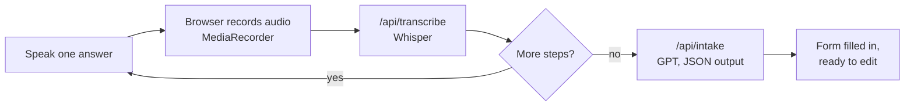
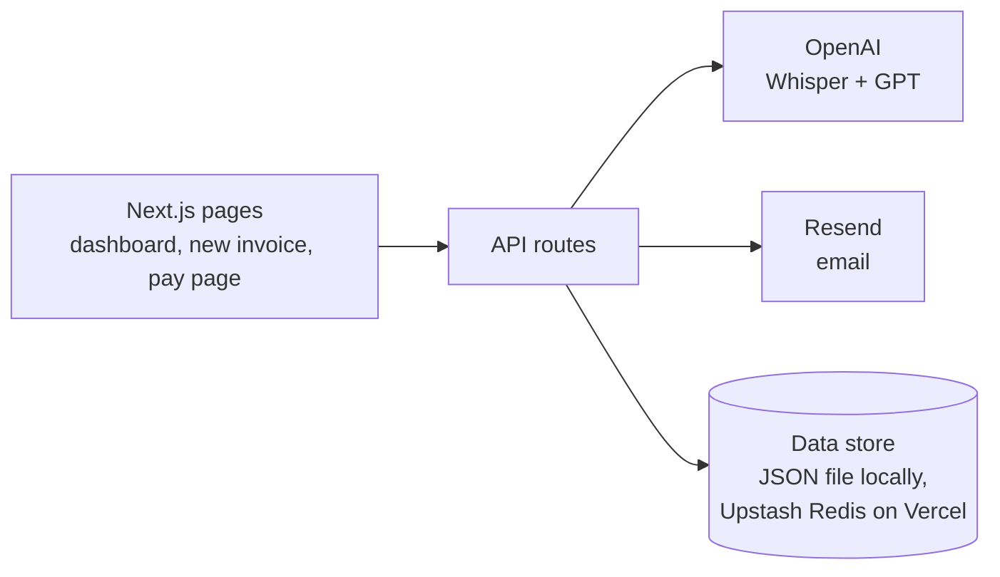

# 📸 Frame

**Invoicing for photographers in the field. Dictate an invoice out loud and send it with a Pay Now link, all in under a minute.**

<p align="center">
  
</p>

<p align="center"><a href="https://youtube.com/shorts/xXgYAstohT8">▶️ Watch the full-quality video on YouTube</a></p>

<p align="center"><i>Built at the Cursor Hackathon.</i></p>

---

## 📌 Overview

Wedding photographers finish a shoot exhausted, drive home, and leave invoicing for "later." Later turns into days, and every day an invoice isn't sent is a day longer before they get paid.

**Frame** lets a photographer send the invoice from their phone before they've even left the venue, by **talking instead of typing**.

---

## ✨ Features

- 🎙️ **Voice dictation**: Tap *Dictate* and answer a few prompts out loud: package, client name, email, event date. OpenAI Whisper transcribes each answer, and GPT turns the speech into clean form fields. "Emma dot patel at example dot com" becomes `emma.patel@example.com`, and "two weeks" becomes a 14-day due date.
- 📦 **Saved packages**: *Wedding Full Day*, *Engagement*, *Album Add-on* and others fill in the line items in one tap.
- 🔗 **Secure Pay link**: Every invoice gets a link the client can open on their phone and pay by card.
- ✉️ **Real email**: Invoices and reminders are sent through Resend as a branded HTML email.
- 💰 **Deposits**: Options to ask for 25% or 50% up front.
- 📊 **Dashboard and activity**: See what's outstanding, what's been collected this month, how long clients take to pay, and when each invoice was sent, reminded, or paid.
- 🗂️ **Client and project intake**, also by voice, so jobs can be logged before they're ready to invoice.

---

## 🛠️ Tech Stack


- **Frontend:** Next.js 16 (App Router), React 19, TypeScript, Tailwind CSS v4 (Fraunces and Inter fonts)
- **AI:** OpenAI Whisper (speech to text) and GPT-4o mini (parsing speech into fields)
- **Email:** Resend
- **Demo recording:** Playwright

---

## 🔄 How Voice Dictation Works



### 1️⃣ One field at a time

- The dialog walks through one field at a time, and each step can be skipped.

### 2️⃣ Transcribe each answer separately

- Each answer is sent to Whisper on its own, so a messy answer only affects its own field.

### 3️⃣ Parse everything with GPT

- All the transcripts are sent to GPT together, with a rule for each field type: an email, a date relative to today, a package name that must match a real package, and so on.
- The model must return JSON and is told **never to invent anything that wasn't said**.

### 4️⃣ Review and send

- The form fills in, and the photographer can review and edit everything before sending.

---

## 🏗️ Architecture



There's no database to set up locally. Data lives in a JSON file that's seeded with sample invoices on first run. Delete `.data/store.json` to reset.

On Vercel, each serverless function gets its own disk, so a file can't be shared between them. When Upstash Redis credentials are set (`KV_REST_API_URL` and `KV_REST_API_TOKEN`), the same store is kept in Redis instead, so every function sees the same data.

---

## 🚀 Installation & Usage

### 📌 Prerequisites

- Node.js 20+ installed.

### ⚡ Quick start (no API keys needed)

```bash
npm install
DEMO_MODE=1 npm run dev
# open http://localhost:3000
```

Demo mode runs the whole app with realistic stand-ins for the paid services. Dictation returns sample speech, parsing returns the fields GPT would produce, and emails are marked sent without going out.

### 🔧 With the real services

```bash
cp .env.example .env.local
# add RESEND_API_KEY and OPENAI_API_KEY
npm run dev
```

In Resend's test mode you can only email your own address. Verify a domain to email clients.

---

## 🎬 Automated Demo

The GIF above isn't screen-recorded by hand. A Playwright script drives the app like a real user, with a fake microphone feeding the voice dictation, and records the whole thing.

```bash
npm run build && DEMO_MODE=1 npm start   # terminal 1
npm run demo                             # terminal 2 -> demo/demo.webm
```

The ffmpeg commands that turn the recording into the GIF and MP4 are at the top of [`scripts/demo.mjs`](scripts/demo.mjs).

---

## 🧠 What I Learned

### ⭐ The most important thing: I'm more capable than I thought
- I went into the hackathon not knowing a lot
- I held my own and contributed real parts of the app, including the idea for voice dictation with Whisper and OpenAI
- **In the future:** I'll take on projects that feel out of reach, because I can figure things out as I go

### 🛠️ Everything else

**🎙️ How to design a voice flow**
- One short question per field, not one long recording, makes dictation reliable
- **In the future:** I can build voice input for any form

**🤖 How to use an LLM as a parser**
- GPT with strict rules and JSON output turns messy speech into clean data
- **In the future:** I can add AI to apps without it making things up

**📱 How browsers record audio differently**
- Chrome and iPhone use different audio formats, so the app detects which one it gets
- **In the future:** I'll test on real devices, not just my laptop

**🎯 How to build from a real problem**
- Every feature aims at one moment: sending the invoice before leaving the venue
- **In the future:** I'll start every project by finding that moment

**✨ How to design for as little friction as possible**
- **Less typing:** talk instead of type, and saved packages fill in line items with one tap
- **Fewer buttons:** dictate, review, send, done
- **Fast:** the app listens instead of making you fill in a form
- **Reliable:** OpenAI cleans up messy speech so the fields come out right
- **Rewarding:** confetti when a client pays, so using it feels good and people come back
- **In the future:** I'll judge every feature by asking: *does this make it simpler, faster or more satisfying?*

**🔒 How small details build trust**
- Time zones, unguessable pay links, no double payments
- **In the future:** I'll check for these in anything involving money

**⏱️ How to scope under time pressure**
- We faked payments and the database to focus on the core idea
- **In the future:** I can apply this at any hackathon or MVP

**🎬 How to create an automated demo with Playwright and ffmpeg**
- A script drives the app with a fake microphone and records it
- **In the future:** I can script demo videos for any project instead of screen-recording

**🧪 How to build a demo mode**
- The app runs with no API keys and no costs
- **In the future:** anyone can try my projects for free

**🚀 How development differs from production**
- Dev-only buttons and read-only servers caught me out
- **In the future:** I'll plan for deployment from the start

---

## 📝 Notes

- **Payments are simulated.** The checkout is a demo screen and no card is ever charged. Connecting Stripe is the next step.
- **Single user.** There are no accounts. It's built around one photographer making it extra lightweight

---

## 🔮 What's Next

- 💳 Real payments with Stripe Checkout
- 👥 Accounts, so more than one photographer can use it
- 🗄️ A real database (Postgres) in place of the JSON file
- 🧾 PDF invoices and automatic payment reminders

---

## 👥 Team

I built this in collaboration with four others at the Cursor Hackathon. The code is co-owned by all five of us.
